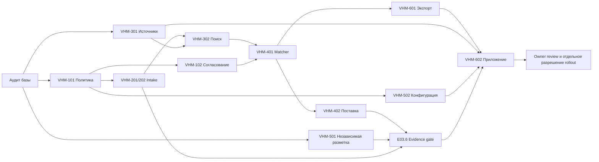

# VHM · зависимости

Стрелка означает, что этап справа требует результата этапа слева для приёмки. Локальные фикстуры, независимая разметка и аудит источников могут начаться раньше. [Реестр задач](VHM_WORKSTREAM_REGISTRY.md)

Исключительное владение файлом действует до integration gate. Maestro распределяет изменения общей спецификации и entrypoint. Изменение интерфейса сначала проходит Contract Review со всеми потребителями.
