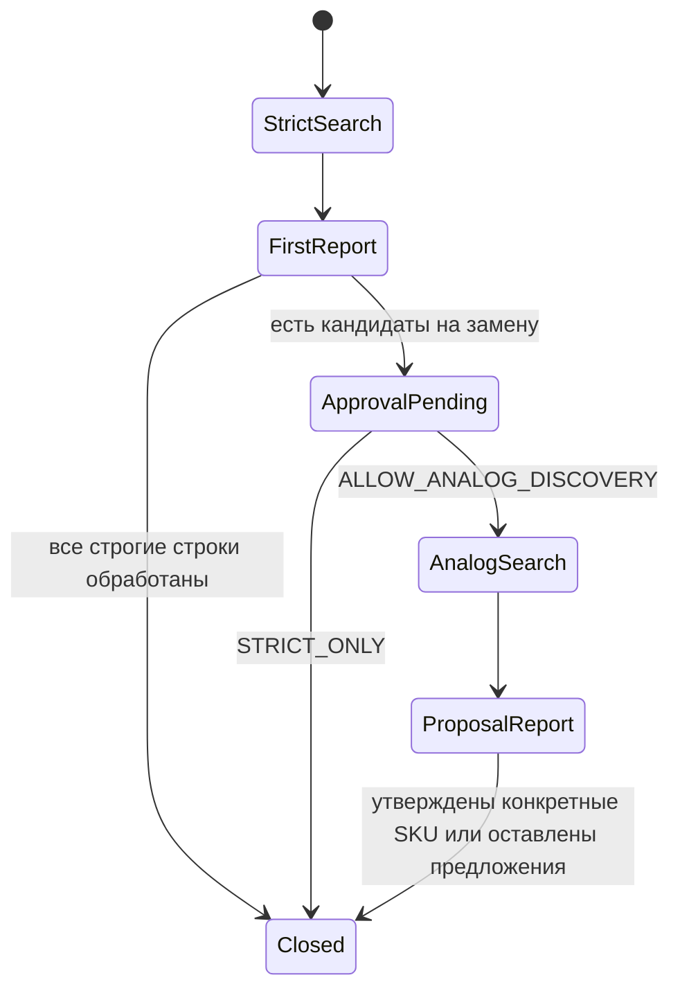

# Пилот и приёмка

Менеджер отправляет заявку один раз и получает Excel с исходными строками, проверенными товарами, предложениями и причинами пробелов. Продолжение требуется для разрешения искать замену или утверждения конкретного SKU. Логистика имеет независимый статус.

Открытые предложения входят в первую выдачу. Разрешение на аналог относится к конкретной заявке и строкам. Закрытая группа требует закрытия каждой её строки. Для покрытия считаются EXACT и утверждённые предложения. Подтверждённая поставка измеряется отдельно.

## Эталон и сравнение

1. Менеджер предоставляет обезличенную заявку около 100 строк. Зафиксировать группы, обязательные параметры, эталонные SKU или причину отсутствия решения. Для ручных находок записать движок, запрос, URL и SKU. Сохранить данные под `runs/`.
2. Прогнать независимые A (MCP), B (MCP → сайт и веб), C (сайт и веб → MCP). Подтверждение карточек MCP и правила решения одинаковы. Использовать один регион и одну версию политики. Записать ручной остаток по Яндексу и сайту отдельно.
3. Для каждой стратегии сверить число строк, ложные EXACT, подтверждённые SKU, согласованные предложения, закрытые группы, доставку и количество вызовов. Сгруппировать незакрытые группы по причинам, учитывая группу один раз на каждую применимую причину. Вклад канала считать по уникальным строкам, впервые получившим подтверждённый SKU через него.
4. Критерии — 100% исходных строк, ноль ложных EXACT и целевое покрытие ≥95%. Среди вариантов без ложных EXACT выбрать максимальное покрытие. При равенстве выбрать меньшее число вызовов, затем B. До замера B остаётся маршрутом пилота.

## Maestro backlog

| Эпик / функция | История / задача | Проверка / свидетельство |
|---|---|---|
| P0 · Приём и политика | Менеджер отправляет одну заявку. Сохранить ключи строк, исходный текст и версию правил | Синтетические тесты и четырёхлистный Excel |
| P0 · Источники и качество | Менеджер видит причину пробела. Сравнить A/B/C с ручным контролем | Эталонная заявка и журнал каналов. Ожидает данные менеджера |
| P0 · Коммерческий подбор | Открытые позиции получают маркированное предложение, замены проходят согласование | Тесты отдельного разрешения и утверждения SKU |
| P1 · Приложение | Подключить единый обработчик к серверному входу после пилота | Проверка серверного доступа к каталогу и решение по AppDeploy |

Сравнение сохранённых результатов: `node src/benchmark.mjs golden.json A/result.json B/result.json C/result.json`. В `golden.json` передай `requestId`, `policyVersion` и `rows` по ключам строк, у каждой строки массив `exactIds` с допустимыми ID карточек. Пустой массив означает отсутствие эталонного точного товара. Ручные находки и причины храни рядом с эталоном.
